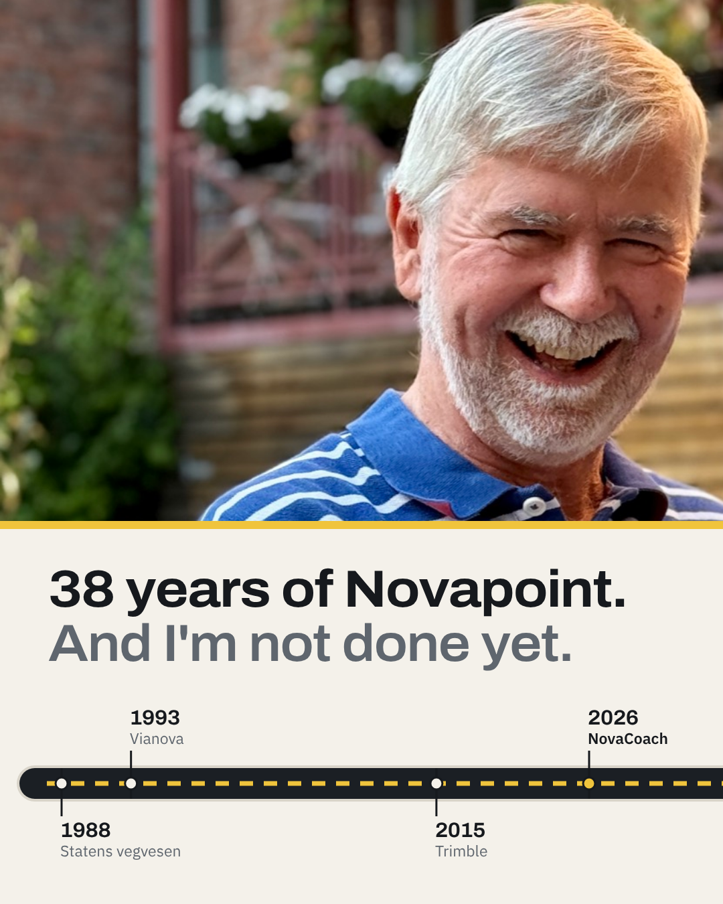
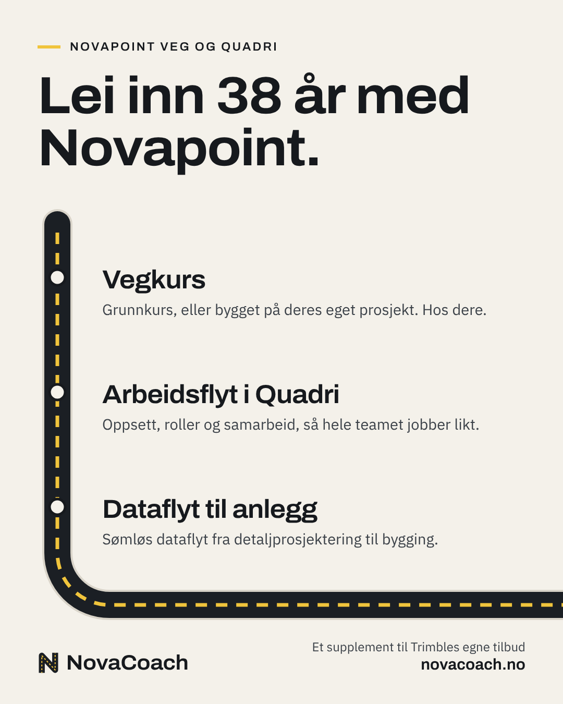
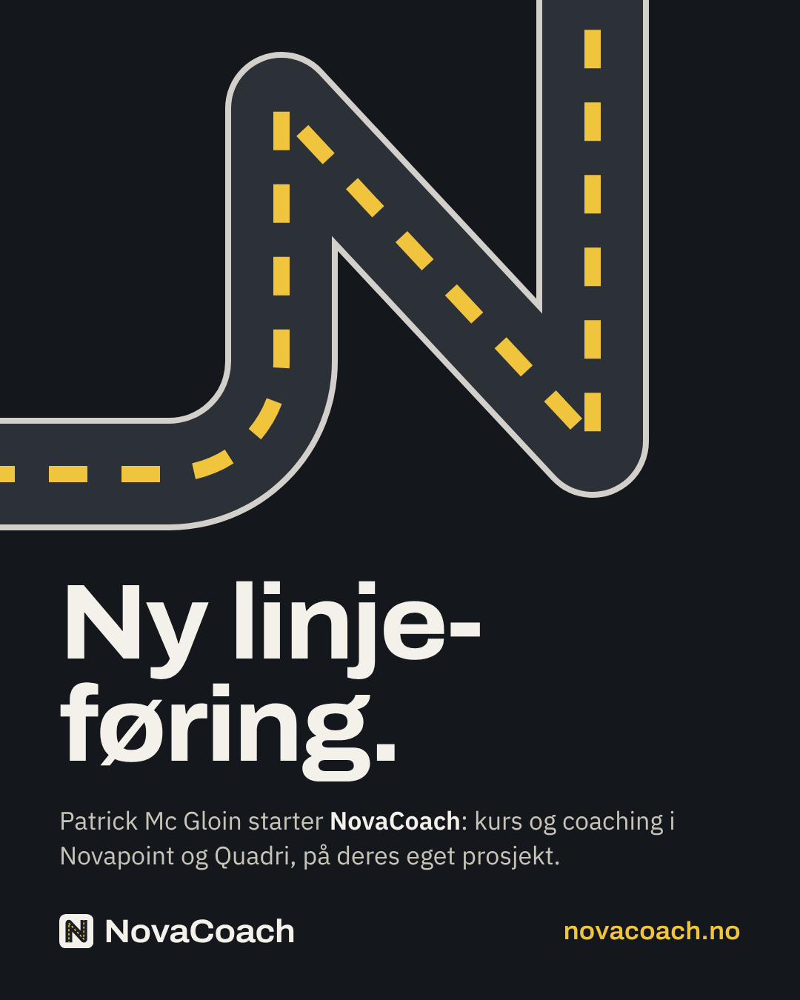
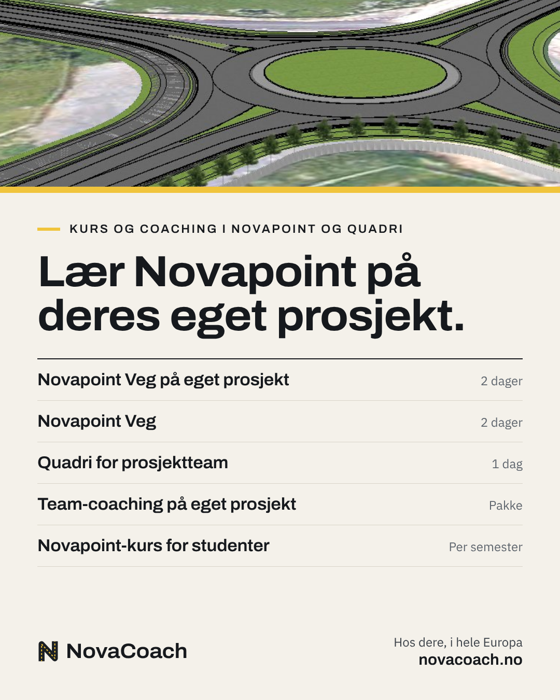
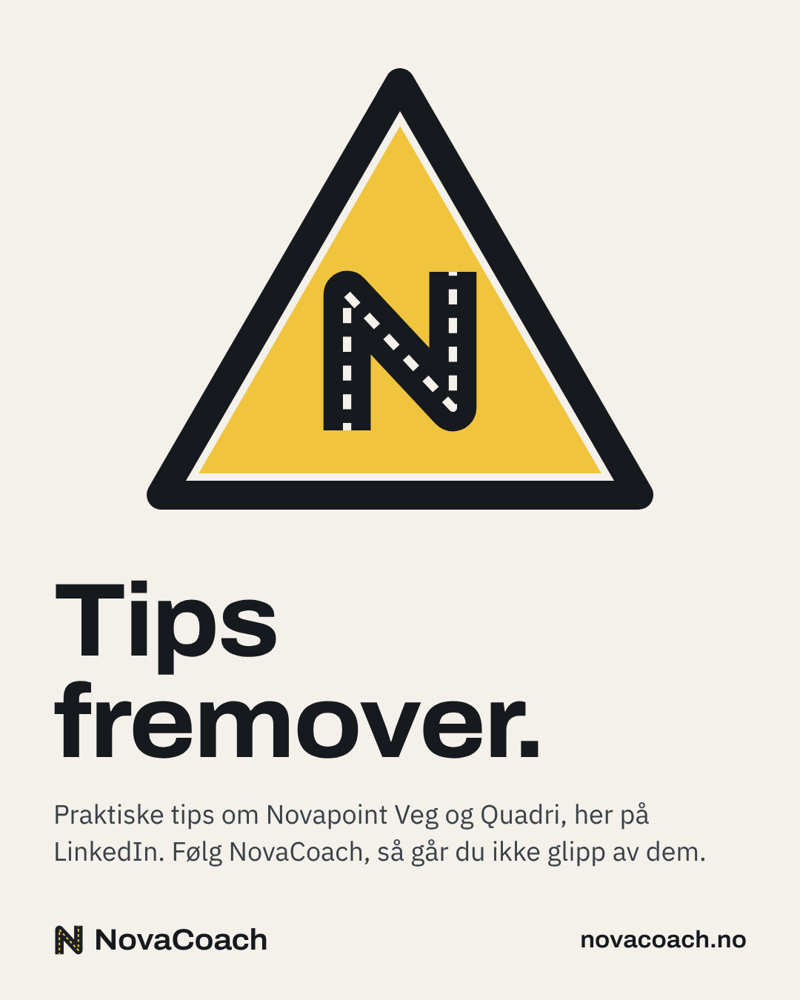
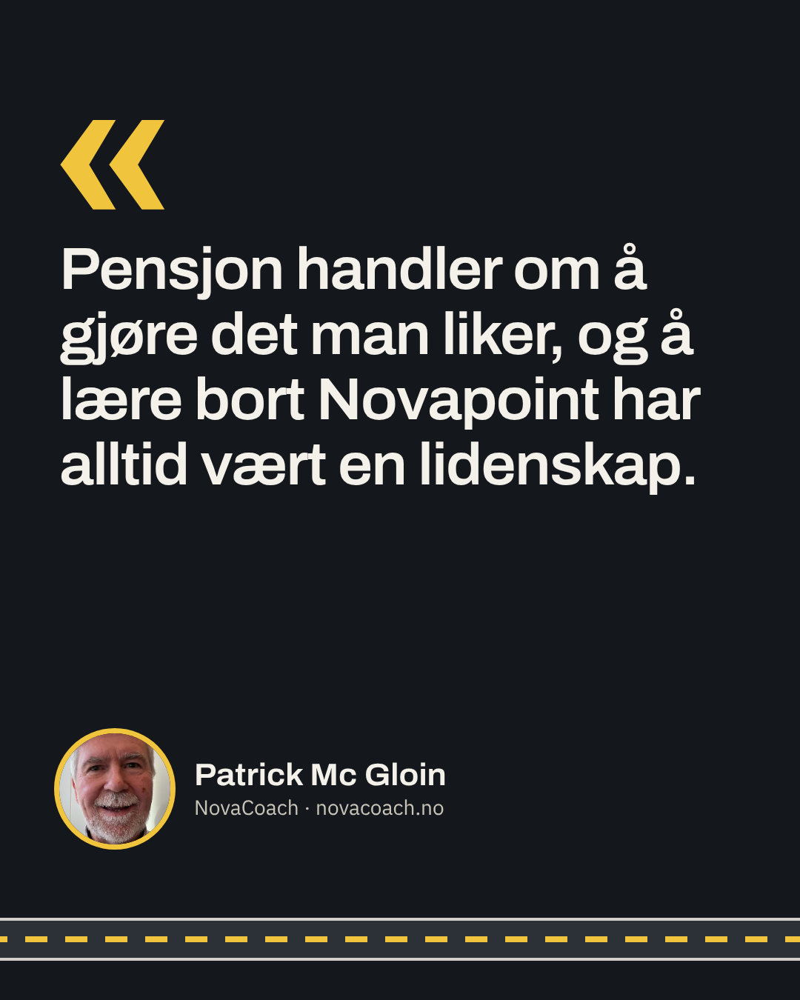
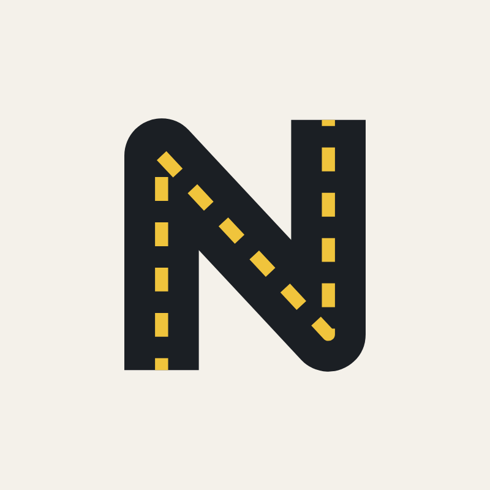
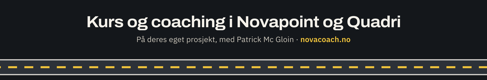
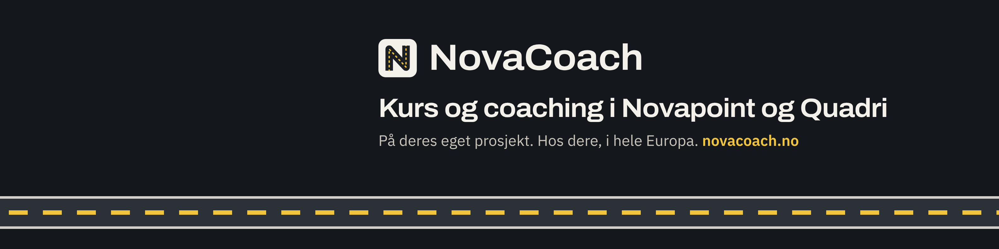
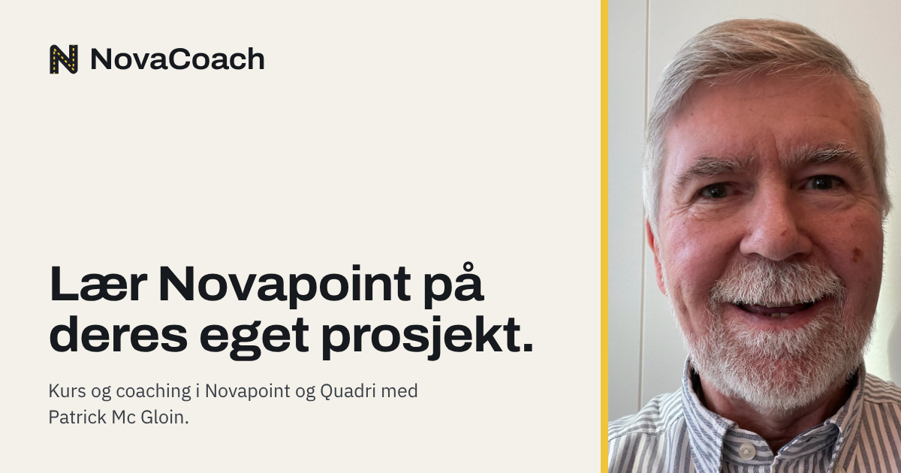

# NovaCoach LinkedIn launch kit

Plan, images and texts for Patrick's last week at Trimble and the NovaCoach launch. This folder sits outside `src/`, so Eleventy never publishes it.

| File | What it is |
|---|---|
| `img/` | 19 PNGs, ready to upload to LinkedIn |
| `README.md` | This file: the plan, open decisions and every text |
| `kit.html` | The same kit as a page. Open it in a browser straight from this folder |
| `frames.html` | Templates for the images, Norwegian and English. Text lives in the `T` object at the bottom |
| `render.js` | Renders `frames.html` into `img/`: `node linkedin/render.js` (uses Playwright and Chromium) |

To change an image: edit the text or layout in `frames.html`, run `node linkedin/render.js`, commit `img/`.

## Open decisions

1. **Last day at Trimble.** The plan assumes Friday 30 October 2026.
2. **When Patrick's post goes out.** Suggested: on the last day. His draft covers both the goodbye and the news, so one post is enough. The profile update on Monday then triggers LinkedIn's "congratulate Patrick" prompt, a second wave without a second post. Keep it bilingual with English first, as he wrote it.
3. **The years in the post.** His draft says 5 + 20 + 10 years (35), the images say 38 (1988–2026). Vianova was 1993–2015 (22 years) and Trimble 2015–2026 (11), so the edited version uses 22 and 11. His call.
4. **Platanus AS in the post.** Suggested: leave it out. Two names in one post makes readers wonder which to follow. The company name is on the site and in the page's About text.
5. **Tell Trimble first.** His draft already positions NovaCoach as a complement to Trimble's own offerings. Give his manager a heads-up before the post, and check the employment agreement for anything on activities after leaving.
6. **Link preview for novacoach.no.** `img/novacoach-og-*.png` (1200×630) can replace the portrait crop LinkedIn shows today. Small site change, one deploy.

## Plan

Dates assume the last day is Friday 30 October. Mornings (08–10) tend to work best for a Norwegian professional audience.

**Tue 27 – Thu 29 Oct: get ready, quietly**
- Finish the site's launch checklist (see the root README): DNS, the patrick@novacoach.no mailbox, form notifications.
- Create the NovaCoach company page with the logo, cover, tagline and About text below. Add Martin as a second admin.
- Publish the offer card as the page's first post. The page has to exist before Patrick's post, so "@NovaCoach" in the post links to it.
- Leave his profile alone while he is still at Trimble.

**Fri 30 Oct, last day: Patrick's post**
- His announcement from his own profile, English then Norwegian, with the timeline (English) and services images.
- Type @NovaCoach and pick the page so it becomes a link. Tag up to five people.
- Family and close colleagues react early and comment with a real memory. Patrick replies to every comment that day.

**Mon 2 Nov: update the profile**
- End the Trimble role, add NovaCoach as the new role linked to the page. Leave "share with network" on.
- New headline and banner. novacoach.no under Featured. Switch on "Providing services".

**Tue 3 Nov: the NovaCoach page goes live**
- The page posts the launch image with the page launch text. Patrick reshares it.
- Invite connections to follow the page. Credits are monthly and come back when someone accepts.

**Wed 4 – Fri 6 Nov: talk to people, keep the promise**
- 20–30 personal messages: former customers, user conference regulars, lecturers who teach Novapoint.
- His post promises tips, so post the first one this week, opened by the tips sign.

**Weeks 2–8: one post a week**, rotating the formats under "What to post next". Ten minutes a day commenting on posts from Norwegian road designers, consultancies and Statens vegvesen.

## Images

| | Image | Size | Use |
|---|---|---|---|
|  | Timeline (`farewell-no/en`) | 1080×1350 | First image in Patrick's post |
|  | Services card (`services-no/en`) | 1080×1350 | Second image in Patrick's post |
|  | Page launch (`launch-no/en`) | 1080×1350 | The page's launch post, Tue 3 Nov |
|  | Offer card (`offer-no/en`) | 1080×1350 | The page's first post |
|  | Tips sign (`tips-no/en`) | 1080×1350 | Opens the tips series |
|  | Quote card (`quote-no/en`) | 1080×1350 | Page post in week 2, or with the personal story |
|  | Company page logo (`logo`) | 800×800 | Page logo |
|  | Company page cover (`cover-no/en`) | 4200×700 | Page cover. Text stays central because the logo overlaps bottom left and phones crop the sides |
|  | Profile banner (`banner-no/en`) | 3168×792 | Patrick's profile background from Mon 2 Nov |
|  | Link preview (`og-no/en`) | 1200×630 | For the website, not for posting |

## Texts

### Patrick's post, edited

```text
After 5 years at the Norwegian Public Roads Administration, 22 years at Vianova and 11 years at Trimble, an exciting new chapter begins.

Thank you to all the colleagues, customers and Novapoint users I have had the pleasure of working with along the way.

I look forward to sharing the knowledge and hands-on experience I've built over the years. Through NovaCoach (novacoach.no), I provide training and project support focused on Novapoint Road and Quadri—now part of the Trimble Infrastructure Design Suite.

I am available to run road design courses, optimize workflows in Quadri, or streamline data flow from detailed design to construction—serving as a complement to Trimble's own offerings.

I will also be sharing practical tips here on LinkedIn, keeping the spotlight on Novapoint Road and Quadri. Follow @NovaCoach so you don't miss them.

———

Etter 5 år i Statens vegvesen, 22 år i Vianova og 11 år i Trimble starter nå et spennende nytt kapittel.

Takk til alle kolleger, kunder og Novapoint-brukere jeg har hatt gleden av å jobbe med underveis.

Jeg ser frem til å dele den kunnskapen og praktiske erfaringen jeg har bygget opp gjennom årene. Gjennom NovaCoach (novacoach.no) tilbyr jeg opplæring og prosjektstøtte med fokus på Novapoint Veg og Quadri – nå en del av Trimble Infrastructure Design Suite.

Jeg kan leies inn til å holde vegkurs, optimalisere arbeidsflyten i Quadri eller effektivisere dataflyten fra detaljprosjektering til anlegg – som et supplement til Trimbles egne tilbud.

Jeg vil også dele praktiske tips her på LinkedIn fremover, med hovedfokus på Novapoint Veg og Quadri. Følg @NovaCoach, så går du ikke glipp av dem.
```

What changed from his draft:
- Vianova 20 → 22 years and Trimble 10 → 11, so the post and the images both add up to 38.
- "Novacoach.no" → "NovaCoach (novacoach.no)".
- The Platanus AS sentence now runs through NovaCoach.
- One new, optional line of thanks.
- The tips line ends with "Follow @NovaCoach".
- A line between the languages. Everything else is Patrick's wording.

### Patrick's original

```text
After 5 years at the Norwegian Public Roads Administration, 20 years at Vianova, and 10 years at Trimble, an exciting new chapter begins.

I look forward to sharing the knowledge and hands-on experience I've built over the years. Through Novacoach.no, I provide training and project support focused on Novapoint Road and Quadri—now part of the Trimble Infrastructure Design Suite.

Through Platanus AS, I am available for hire to conduct road design courses, optimize workflows in Quadri, or streamline data flow from detailed design to construction—serving as a complement to Trimble's own offerings.

I will also be sharing practical tips here on LinkedIn, keeping the spotlight on Novapoint Road and Quadri.

Etter 5 år i Statens vegvesen, 20 år i Vianova og 10 år i Trimble starter nå et spennende nytt kapittel.

Jeg ser frem til å dele den kunnskapen og praktiske erfaringen jeg har bygget opp gjennom årene. Gjennom Novacoach.no tilbyr jeg opplæring og prosjektstøtte med fokus på Novapoint Veg og Quadri – nå en del av Trimble Infrastructure Design Suite.

Gjennom Platanus AS kan jeg leies inn til å holde vegkurs, optimalisere arbeidsflyten i Quadri eller effektivisere dataflyten fra detaljprosjektering til anlegg – som et supplement til Trimbles egne tilbud.

Jeg vil også dele praktiske tips her på LinkedIn fremover, med hovedfokus på Novapoint Veg og Quadri.
```

### Page launch post (from the NovaCoach page, Tue 3 Nov)

```text
Ny linjeføring.

NovaCoach er i gang: opplæring, coaching og prosjektstøtte i Novapoint Veg og Quadri med Patrick Mc Gloin, gjerne på deres eget prosjekt.

Følg siden for praktiske tips om Novapoint Veg og Quadri. Les mer og meld interesse på novacoach.no.
```

```text
Changing lanes.

NovaCoach is up and running: Novapoint Road and Quadri training, coaching and project support with Patrick Mc Gloin, ideally on your own project.

Follow the page for practical tips on Novapoint Road and Quadri. More, and a short interest form, at novacoach.no/en/.
```

### Company page

| Field | Value |
|---|---|
| Name | NovaCoach |
| Page URL | linkedin.com/company/novacoach, if it's free |
| Website | https://novacoach.no |
| Industry | Professional Training and Coaching |
| Size and type | 0–1 employees, privately held |
| Location | Oslo, Norway |
| Button | Visit website, pointing at novacoach.no |

Tagline:

```text
Opplæring og prosjektstøtte i Novapoint Veg og Quadri, på deres eget prosjekt.
```

```text
Novapoint Road and Quadri training and project support, on your own project.
```

About (LinkedIn lets you add both languages):

```text
NovaCoach tilbyr opplæring og prosjektstøtte i Novapoint Veg og Quadri, gjerne på deres eget prosjekt, som et supplement til Trimbles egne tilbud.

Kursene holdes av Patrick Mc Gloin, som har jobbet med Novapoint siden den het NovaCAD. Han var med på å bygge verktøyene gjennom mer enn 30 år i Vianova og Trimble, som daglig leder, fagansvarlig for Novapoint Veg og produktdirektør.

Kurs og pakker:
• Novapoint Veg på eget prosjekt (2 dager, hos dere)
• Novapoint Veg, grunnkurs (2 dager, hos dere)
• Quadri for prosjektteam (1 dag, hos dere)
• Team-coaching på eget prosjekt, digitalt eller hos dere
• Novapoint-kurs for universiteter og høgskoler

For byggherrer og vegeiere, rådgivere og utdanningsinstitusjoner. Vi kommer til dere, i hele Europa.

NovaCoach er en tjeneste levert av PLATANUS AS, org.nr 925 510 483. Novapoint, Quadri og Trimble er varemerker som tilhører Trimble Inc. NovaCoach er uavhengig og ikke tilknyttet Trimble.
```

```text
NovaCoach offers Novapoint Road and Quadri training and project support, ideally on your own project, as a complement to Trimble's own offerings.

Courses are run by Patrick Mc Gloin, who has worked with Novapoint since it was called NovaCAD. He helped build the tools over more than 30 years at Vianova and Trimble, as CEO, domain lead for Novapoint Road and product director.

Courses and packages:
• Novapoint Road on your own project (2 days, on site)
• Novapoint Road, standard course (2 days, on site)
• Quadri for project teams (1 day, on site)
• Team coaching on your own project, online or on site
• Novapoint courses for universities and colleges

For road authorities and public clients, consultancies, and universities. We come to you, anywhere in Europe.

NovaCoach is a service delivered by PLATANUS AS, org. no. 925 510 483. Novapoint, Quadri and Trimble are trademarks of Trimble Inc. NovaCoach is independent and not affiliated with Trimble.
```

### Patrick's profile (Mon 2 Nov)

Headline:

```text
Opplæring og prosjektstøtte i Novapoint Veg og Quadri · NovaCoach · Med Novapoint siden 1988
```

```text
Novapoint Road and Quadri training and project support · NovaCoach · With Novapoint since 1988
```

New role: title "Grunnlegger og kursholder" / "Founder and trainer", company NovaCoach (pick the page so the logo shows), start month the month after the last Trimble day, "share with network" on.

Role description:

```text
Kurs og coaching i Novapoint Veg og Quadri, på deres eget prosjekt og hos dere, i hele Europa. Grunnkurs, kundetilpassede kurs, team-coaching og undervisning for universiteter og høgskoler. novacoach.no
```

```text
Novapoint Road and Quadri training and coaching, on your own project and at your office, anywhere in Europe. Standard and tailored courses, team coaching, and teaching for universities and colleges. novacoach.no
```

### Personal messages (launch week)

Add one personal line to each, like a shared project or user conference.

```text
Hei [navn]! Etter mange år i Vianova og Trimble har jeg startet NovaCoach. Jeg holder kurs og coaching i Novapoint og Quadri, gjerne på teamets eget prosjekt. Hvis dere har folk som skal bli bedre i Novapoint Veg eller Quadri fremover, tar jeg gjerne en prat. Mer på novacoach.no.
```

```text
Hi [name]! After many years at Vianova and Trimble I've started NovaCoach. I run Novapoint and Quadri training and coaching, ideally on the team's own project. If you have people who need to get better at Novapoint Road or Quadri, I'd be glad to talk. More at novacoach.no/en/.
```

For lecturers:

```text
Hei [navn]! Jeg har startet NovaCoach, og ett av tilbudene er å kjøre Novapoint-undervisningen for studentene deres, på skolens lisenser og labber, med øvinger som er oppdatert for gjeldende versjon. Da kan du bruke tiden på faget. Passer det å ta en prat før neste semester planlegges? novacoach.no/kurs/
```

```text
Hi [name]! I've started NovaCoach, and one of the things I offer is running the Novapoint teaching for your students, on the institution's licences and labs, with exercises updated for the current version. That leaves you the time for the subject itself. Could we talk before next semester is planned? novacoach.no/en/courses/
```

### Personal story (optional, a week or two later)

Also works as the first "From the archive" post, with the quote card.

```text
In 1988 I was a young road designer at Statens vegvesen in Drammen, drawing the E18 through Kobbervikdalen by hand. The office had just started using something called NovaCAD, and I threw myself at it.

In 1993 Vianova called. That was the start of more than 30 years building Novapoint: as CEO, as domain lead for Novapoint Road, as chairman when Trimble bought Vianova in 2015, and in recent years as product director for Novapoint, Quadri, Quantm and Geosuite.

What I'm proudest of isn't a feature. It's the user conferences, and the community of road designers who shared best practice, ideas and enthusiasm for the craft there, year after year.

People keep wishing me a happy retirement. I'll take it. But for me, retirement is about doing what you love, and teaching Novapoint has always been my passion. That's what I do now, as NovaCoach.
```

```text
I 1988 var jeg ung vegplanlegger hos Statens vegvesen i Drammen og tegnet E18 gjennom Kobbervikdalen for hånd. Kontoret hadde nettopp tatt i bruk noe som het NovaCAD, og jeg kastet meg over det.

I 1993 ringte Vianova. Det ble starten på over 30 år med å bygge Novapoint: som daglig leder, som fagansvarlig for Novapoint Veg, som styreleder da Trimble kjøpte Vianova i 2015, og de siste årene som produktdirektør for Novapoint, Quadri, Quantm og Geosuite.

Det jeg er stoltest av, er ikke en funksjon. Det er brukermøtene, og fellesskapet av vegplanleggere som delte beste praksis, ideer og entusiasme for faget, år etter år.

Mange ønsker meg en god pensjonisttilværelse. Den skal jeg ha. Men for meg handler pensjon om å gjøre det man liker, og å lære bort Novapoint har alltid vært en lidenskap. Det er det jeg gjør nå, som NovaCoach.
```

## What to post next

- **The tip of the week.** One Novapoint or Quadri function most users don't know, with a screenshot.
- **From the archive.** The E18 through Kobbervikdalen on paper, the first NovaCAD, Vianova's office in Thailand, the user conferences. An old photo beats any graphic.
- **R110 in plain words.** One requirement from R110 Modellgrunnlag explained with a model view.
- **From a course.** Once the first course has run, what the team built on its own project. Ask the customer first.

## Sources for image sizes

LinkedIn changes these from time to time. If an upload looks cropped, re-render at another size.

- [ManyPixels: LinkedIn banner sizes 2026](https://www.manypixels.co/blog/social-media-design/linkedin-banner-size)
- [MeetEdgar: LinkedIn size guide](https://meetedgar.com/blog/linkedin-size-guide)
- [LinkedIn Help: invitations to follow a Page](https://www.linkedin.com/help/linkedin/answer/a6202478)
